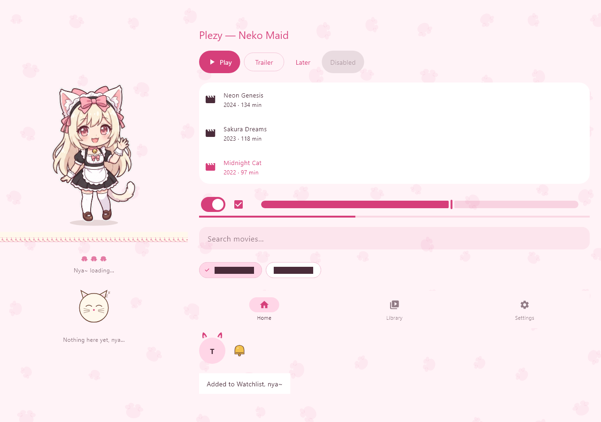
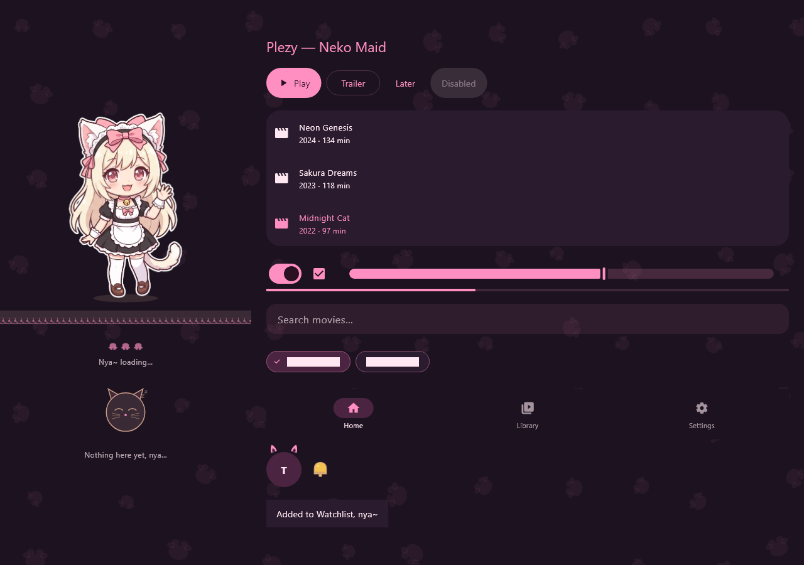

# Plezy Neko 🐾
*A cute, Windows-focused, catgirl-maid themed fork of Plezy! Nya~*

## 🌸 What is this?
Welcome! **Plezy Neko** is a specialized, aesthetic fork of [Plezy](https://github.com/edde746/plezy) (by edde746), a fantastic Flutter client for Plex, Jellyfin, and Emby.

This fork keeps **all** the amazing upstream features of the original app but sprinkles in a cozy, cute aesthetic and a dedicated Windows desktop focus! Best of all, it has a completely separate app identity (its own window title, icon, and data folder), meaning you can safely run it right alongside the official Plezy app without any conflicts.

## 📦 Download & Install (Windows 10/11, x64)

Grab the latest build from the [**Releases page**](https://github.com/GeoffryWashington/plezy-neko/releases/latest):

* **`plezy-neko-setup.exe`** (recommended): a one-click installer. It installs just for you (no admin prompt), adds a *Plezy Neko* desktop shortcut and Start-menu entry, and can be removed from *Settings > Apps*. It runs side by side with the official Plezy and never touches it.
* **`plezy-neko-windows-x64-portable.7z`**: no install, just extract anywhere and run `plezy.exe`.

Everything needed for playback ships inside: mpv/FFmpeg with all the common video and audio codecs (H.264, HEVC, AV1, VP9, TrueHD, DTS-HD, E-AC-3, FLAC…) and the Visual C++ runtime. Nothing else to install, nya~

## ✨ Features & Additions

* **Catgirl Themes:** Introduces *Neko Maid* (pastel sakura pink and cream, the new default) and *Neko Night* (plum and sakura pink). The original Plezy themes are still available!
* **One-Click Theme Toggle:** Easily swap to the cute stuff using the 'Catgirl theme' toggle in Appearance settings or the handy paw button in the side menu! Turning it off perfectly restores your previous theme.
* **Your Personal Chibi Mascot:** An original chibi catgirl-maid hangs out in the side menu and sign-in screen! She features a gentle idle bob, blinks, and does a happy cheer animation when clicked! *(Can be hidden in settings if you prefer).*
* **Cozy UI Touches:** Enjoy a paw-print wallpaper on the sign-in screen, delicate lace trim, a hopping-paws "Nya~ loading..." loader, and a sleepy cat illustration on empty screens.
* **Rounded Typography:** In the Neko themes, app text is rendered in the soft and friendly *M PLUS Rounded 1c* font.
* **Themed Video Player:** While using the Neko themes, the player features a pink seek bar with a paw-print handle, a little bell icon for play/pause, and a paw loader!
* **✨ Enhance (live picture tuning):** Click the sparkle button on the player bar to sharpen or upscale the picture while you watch. It's off by default, so playback stays as light as possible.
  * **Method:** NVIDIA Image Scaling, AMD FSR 1.0, AMD CAS, ArtCNN, Anime4K or your own GLSL shaders. On NVIDIA RTX cards you also get **RTX Video Super Resolution**.
  * **Picture sliders:** Sharpness, brightness, contrast, saturation, gamma and hue, remembered between sessions.
  * **Before / after preview:** A side-by-side preview with a draggable divider, so you can see exactly what each setting does.
* **One-Click Updates:** When a new release is out, a small update icon appears in the home screen's top bar. Click it, hit *Update*, and Plezy Neko downloads the new version, installs it and restarts itself.
* **Plex Playback Fix:** If a Plex server refuses direct play with an HTTP 5xx error (because the stream exceeds its remote bandwidth limit), Plezy Neko will automatically probe and fall back to a 20 Mbps server transcode—just like the official Plex apps do!
  * *Tip for Server Owners:* List your home network in Plex `Settings > Network > LAN Networks` so your local devices aren't accidentally treated as remote!

## 📸 Screenshots

| Neko Maid Theme | Neko Night Theme |
|:---:|:---:|
|  |  |

## 🛠️ Building on Windows

Plezy Neko is built specifically for Windows desktop. To build it yourself, you will need:
* **Flutter `3.47.1` exactly**
* Windows Developer Mode **turned on**
* Visual Studio 2022 Build Tools (with the **C++ desktop workload** installed)
* A JDK (Temurin 21) with `JAVA_HOME` set

**Build Steps** (from the repository root, in PowerShell):
1. Fetch dependencies: `flutter pub get`
2. Precache Windows tools: `flutter precache --windows`
3. Install the patched engine: `.\windows\tool\install-patched-engine.ps1`
   *(Note: This is Plezy's patched DirectComposition engine. It is strictly required, otherwise the player controls will hide behind the video!)*
4. Run the build runner: `dart run build_runner build`
5. Build the release executable: `flutter build windows --release`

Your finished build will be ready at: `build/windows/x64/runner/Release/plezy.exe`.

## 🎨 Art & Fonts
* **Mascot & Icon:** The chibi catgirl-maid and app icon are original characters/assets created for this fork (generated with Google Gemini). They do not belong to any existing franchise!
* **Font:** The app uses *M PLUS Rounded 1c*, licensed under the SIL Open Font License (see `assets/fonts/mplus_rounded/OFL.txt`).
* **Enhance shaders:** AMD FidelityFX FSR 1.0 and CAS (© Advanced Micro Devices, MIT license) via the mpv ports by agyild; NVIDIA Image Scaling, ArtCNN and Anime4K ship with upstream Plezy.

## 📜 Credits & License
Plezy Neko is licensed under **GPL-3.0**, matching the upstream repository.

Massive credit and gratitude goes to **edde746** for creating [Plezy](https://github.com/edde746/plezy). All core media client features, playback architecture, and original themes belong to upstream. Thank you for the amazing foundation! The original upstream README is kept at [docs/UPSTREAM_README.md](docs/UPSTREAM_README.md).
